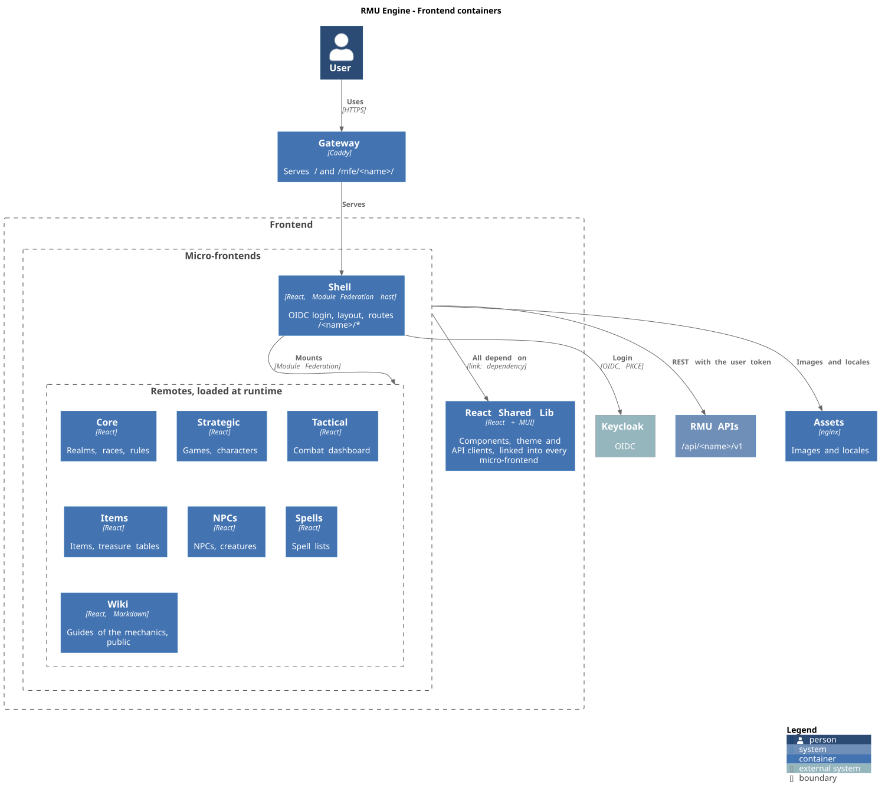

= Frontends
:toc: left

The UI is a set of React applications composed at runtime with *Webpack Module Federation*. Each one lives in its own `rmu-mfe-*` repository (see link:services.adoc#_micro_frontends[the catalog]).

== Module Federation contract

* `rmu-mfe-shell` is the *host*. It handles the OIDC login (`react-oidc-context`), the layout and the routes.
* Each domain MFE is a *remote* named after its domain (`core`, `strategic`, `tactical`, `npcs`, `items`, `spells`). It publishes `<name>-app.js` and exposes `./<Name>App`, for example `core/CoreApp`.
* The shell loads each remote from `<RMU_MFE_<NAME>_PUBLIC_PATH><name>-app.js` and mounts it lazily under `/<name>/*`.
* React, MUI, emotion, react-router, react-oidc-context/oidc-client-ts and i18next are shared *singletons*. A remote's versions must stay compatible with the shell's `package.json`.
* Shared UI components come from `@labcabrera-rmu/rmu-react-shared-lib`, which is not on npm. Each MFE declares it as `link:../rmu-react-shared-lib` in `package.json`, so `pnpm install` links the sibling checkout. `make link-shared-lib` builds the lib's `dist/` and runs that install. Webpack resolves the lib's peer dependencies (react, MUI…) from the MFE's own `node_modules` (`resolve.modules`), so each bundle keeps a single copy.

When adding an MFE, update together:

. the `remotes` block in the shell's `webpack.config.ts`,
. the route in the shell's `App.tsx`,
. the `RMU_MFE_<NAME>_PUBLIC_PATH` variable in the shell's `.env.example`,
. the catalog in link:services.adoc[], and the frontends diagram (`docs/diagrams/c4-containers-frontends.plantuml`).

== Configuration

No URL is baked into the bundles. Each MFE lists its keys in `public/env-config.template.js`, and the browser reads them from `window.__RMU_CONFIG__`, loaded from `/env-config.js`: the dev server builds it from `.env.<mode>` (for example `.env.development`) or `.env`, and the nginx image from the container environment. See link:configuration.adoc#_mfes_runtime_configuration[MFEs: runtime configuration].

Shell variables:

[options="header",cols="2,3"]
|===
|Variable |Purpose

|`RMU_IAM_URI`, `RMU_IAM_REALM`, `RMU_IAM_CLIENT_ID`
|Keycloak and the public PKCE client `rmu-client-front`. Locally `http://localhost/sso` (through the gateway, on the shell's origin), `rmu`, `rmu-client-front`.

|`RMU_MFE_ASSETS_URI`, `RMU_MFE_I18N_URI`
|Static assets and locales served by `rmu-mfe-assets` (`/mfe/assets/` through the gateway).

|`RMU_MFE_<NAME>_PUBLIC_PATH`
|Where each remote is served, with a trailing slash. For example `/mfe/core/` for core.

|`RMU_API_<NAME>_URI`
|APIs, behind the gateway at `/api/<name>/v1`. The remotes read them from the shell's configuration.

|`RMU_SHELL_CONTACT_URI`, `RMU_SHELL_CONTACT_EMAIL`
|Contact page (optional).

|`RMU_ADMIN_KEYCLOAK_URI`, `RMU_ADMIN_KAFKA_UI_URI`, `RMU_ADMIN_GRAFANA_URI`
|Operation tools that the shell's `/admin/tools` links for administrators (optional, workspace spec 053). Leave them unset where they must not be exposed.
|===

Domain MFEs read `RMU_API_<NAME>_URI` for the APIs they call and `RMU_MFE_ASSETS_URI`. Inside the shell they use the shell's values; their own `.env` only applies when they are opened standalone on their dev server port. Naming rules: link:configuration.adoc[].

== Where the MFEs run

[options="header",cols="1,3"]
|===
|Mode |How

|Compose, `mfes` profile
|shell, core, strategic, tactical, npcs, items, spells and assets run from static nginx images behind the gateway, configured at runtime through `env-config.js`. A stopped container falls back to its dev server; see link:../local-development.adoc#_working_on_one_mfe[Working on one MFE]. Design: `specs/001-mfes-in-compose` in the workspace root.

|Development, all from source
|`make mfes-dev` opens one terminal tab per checked-out MFE running `pnpm run start:live`, plus the assets server. Open them through the gateway (http://localhost) with the containers stopped. `BASE_DIR` (or `RMU_WORKSPACE_DIR`) selects the folder holding the checkouts; it defaults to the parent folder of `rmu-platform`.

|AWS (planned)
|The same images on EC2 behind the gateway, or the same bundles on S3 behind CloudFront.
|===

== Static image contract

Each MFE repository builds `labcabrera/rmu-mfe-<name>` with `make docker-build` (tag `local`) and publishes it with `make docker-push IMAGE_TAG=<version>`. The image:

* builds the production bundle and serves `dist/` with nginx on port 80 (`rmu-react-shared-lib` comes from a BuildKit named context until it is published);
* takes its URLs at runtime: the template mechanism of the nginx image renders `public/env-config.template.js` into `env-config.js` from the container environment;
* uses `publicPath: 'auto'` (remotes), so it works under any prefix (`/mfe/<name>/`, a dev server, a CDN);
* sends `Cache-Control: no-cache` (chunk names carry no content hash yet) and an open CORS header.

To add an MFE: its service in `compose/mfes.yaml` (`<<: *mfe-common` and an `RMU_MFE_<NAME>_VERSION` variable), its `/mfe/<name>/` route with the dev server fallback in `compose/config/caddy/Caddyfile`, and `RMU_MFE_<NAME>_PUBLIC_PATH` in the shell.
