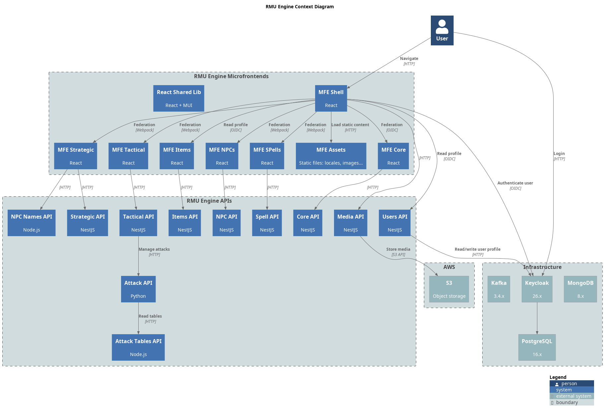

= Architecture overview
:toc: left

*RMU Engine* is an online assistant for playing *Rolemaster Unified* games.

The source of the diagram is link:diagrams/c4-context.plantuml[]. Render the PNG again after changing it.

== Building blocks

* *Micro-frontends*: React applications composed at runtime with Webpack Module Federation. `rmu-mfe-shell` handles the OIDC login and the layout, and mounts one remote per domain (core, strategic, tactical, items, npcs, spells). Images and locales come from `rmu-mfe-assets`. See link:frontends.adoc[].
* *APIs*: mostly NestJS, plus the Attack API (Python/FastAPI) and the Attack Tables and NPC Names APIs (Node.js). See link:services.adoc[] for the full catalog.
* *Infrastructure*:
** *MongoDB*: one database per API (`rmu-core`, `rmu-strategic`, ...) on a shared instance.
** *Kafka*: domain events between APIs.
** *Keycloak*: OIDC provider, backed by *PostgreSQL*. See link:auth.adoc[].
** *S3*: images managed by the Media API, published under `MEDIA_ASSETS_URI`.

== Call flow

* The browser loads the shell, logs in against Keycloak and sends the access token to every API.
* Each MFE calls its own domain API (core → Core API, strategic → Strategic API, ...). The shell also calls the Users and Media APIs.
* APIs call each other over HTTP at `http://rmu-api-<name>:<port>/v1`, forwarding the caller's token or using a service-account token from the confidential `rmu-client`.
* The main chains are:
** Tactical → Core, Strategic, Items, NPCs and Attack.
** Attack → Attack Tables.
** Strategic → Core and Items.
** NPCs → Core, Items and Attack Tables.

== Kafka events

APIs publish domain events and react to the events of other domains, for example to keep denormalized copies up to date or to clean up after a deletion.

* Topics follow the pattern `internal.<service>.<entity>.<event>.v1`, for example `internal.rmu-core.realm.updated.v1` or `internal.rmu-tactical.game.created.v1`.
* Locally topics are auto-created with a single partition (`RMU_KAFKA_DEFAULT_PARTITIONS=1`).
* Each API consumes with its own group, `rmu-api-<name>-consumer`.
* Kafka UI (`tools` profile, http://localhost:8091) shows topics and messages.

== Observability

The `observability` profile runs `grafana/otel-lgtm` (Grafana, Loki, Tempo, Prometheus and an OpenTelemetry collector). APIs are expected to export OTLP to `rmu-otel:4317` (gRPC) or `rmu-otel:4318` (HTTP). Instrumenting each API is work in its own repository; see link:../local-development.adoc#observability[Local development].
