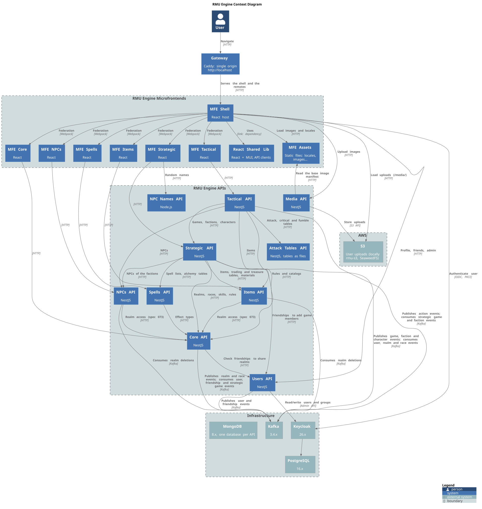

= Architecture overview
:toc: left

*RMU Engine* is an online assistant for playing *Rolemaster Unified* games.

The source of the diagram is link:diagrams/c4-context.plantuml[]. After changing a `.plantuml` file, render its SVG again with `make diagrams` (or `docs/architecture/diagrams/render.sh [<file>]`), which runs PlantUML from its Docker image, and commit both files.

== Building blocks

* *Micro-frontends*: React applications composed at runtime with Webpack Module Federation. `rmu-mfe-shell` handles the OIDC login and the layout, and mounts one remote per domain (core, strategic, tactical, items, npcs, spells). Images and locales come from `rmu-mfe-assets`. See link:frontends.adoc[].
* *APIs*: NestJS on the `rmu-api-core` template, plus NPC Names (plain Node.js). Attack Tables is NestJS without Mongo or Kafka: its tables are files. The Python Attack API was retired: tactical computes the attacks since workspace spec 003. See link:services.adoc[] for the full catalog.
* *Gateway*: Caddy, the single origin of the application (http://localhost locally). It serves the shell at `/`, the remotes at `/mfe/<name>/`, the APIs at `/api/<name>/`, Keycloak at `/sso/` and the uploads at `/media/`. See link:../local-development.adoc#_gateway[Gateway].
* *Infrastructure*:
** *MongoDB*: one database per API (`rmu-core`, `rmu-strategic`, ...) on a shared instance.
** *Kafka*: domain events between APIs.
** *Keycloak*: OIDC provider, backed by *PostgreSQL*. See link:auth.adoc[].
** *S3*: the images users upload, managed by the Media API under `uploads/` of its bucket (locally the `rmu-s3` service, ADR 0011). The base images are the files of `rmu-mfe-assets`. See link:configuration.adoc#_asset_paths[Asset paths].

== Call flow

* The browser loads the shell, logs in against Keycloak and sends the access token to every API.
* Each MFE calls its own domain API (core → Core API, strategic → Strategic API, ...). The API clients and many components (pickers, rule tables) live in `rmu-react-shared-lib`, so an MFE also calls the other APIs those components need. The shell also calls the Users and Media APIs.
* APIs call each other over HTTP at `http://rmu-api-<name>:<port>/v1` (`RMU_API_<NAME>_URI`), forwarding the caller's token or using a service-account token from the confidential `rmu-client`.
* The calls between APIs are:
** Tactical → Core, Strategic, Items, NPCs and Attack Tables.
** Strategic → Core, Items (items, trading and treasure tables, materials), Spells (spell lists, alchemy tables), NPCs and Users (friendships).
** Items, NPCs → Core (realm access, spec 073).
** Spells → Core (effect types).
** Core → Users (friendships, to share realms).

== Kafka events

APIs publish domain events and react to the events of other domains, for example to keep denormalized copies up to date or to clean up after a deletion.

* Topics follow the pattern `internal.<service>.<entity>.<event>.v1`, for example `internal.rmu-core.realm.updated.v1` or `internal.rmu-tactical.game.created.v1`.
* Locally topics are auto-created with a single partition (`RMU_KAFKA_DEFAULT_PARTITIONS=1`).
* Each API consumes with its own group, `rmu-api-<name>-consumer`.

[options="header",cols="2,3,3"]
|===
|Publisher |Events |Consumers

|Users
|`user.updated` (name change)
|Core and Strategic, which keep a copy of the user name.

|Users
|`friendship.updated`, `friendship.deleted`
|Core: removes the realm shares of a blocked or deleted friendship (spec 069).

|Core
|`realm.updated`, `realm.deleted`
|Core (races follow their realm); Strategic, Items and NPCs delete what hangs from a deleted realm (spec 073).

|Core
|`race.updated`
|Strategic: updates the characters of the race.

|Strategic
|`game.created`, `game.updated`, `game.deleted`
|Core shares the realm with the members (spec 072); Tactical copies members and faction players; Strategic deletes the factions and items of a deleted game.

|Strategic
|`faction.created`, `faction.updated`, `faction.deleted`
|Tactical.

|Strategic
|`character.deleted`, `character.race-updated`
|Strategic itself.

|Tactical
|`action.created` (every action event)
|None yet.
|===
* Kafka UI (`tools` profile, http://localhost:8091) shows topics and messages.

== Observability

The `observability` profile runs `grafana/otel-lgtm` (Grafana, Loki, Tempo, Prometheus and an OpenTelemetry collector). APIs are expected to export OTLP to `rmu-otel:4317` (gRPC) or `rmu-otel:4318` (HTTP). Instrumenting each API is work in its own repository; see link:../local-development.adoc#observability[Local development].
